<p align="center">
  
</p>

<p align="center">
  
</p>

<p align="center">
  
  
  
  <a href="https://roadmap.sh/projects/number-guessing-game"></a>
</p>

# 🎯 Number Guessing Game

A command-line number guessing game built in Java, where the computer picks a secret number between 1 and 100 and challenges you to find it — with clues, hints, a ticking clock, and bragging-rights high scores to keep you coming back.

**Project URL :** https://roadmap.sh/projects/number-guessing-game

<p align="center"></p>

## 📖 About

This isn't just "guess a number and get told higher or lower." It's a small, self-contained game engine with difficulty tiers, a single-use hint system, round timing, and persistent high scores (per session) across Easy, Medium, and Hard modes. The whole thing runs in your terminal — no dependencies beyond core Java.

## 📋 Project Overview

This project is a hands-on coding challenge focused on building a simple, fully playable number guessing game for the command line. The core idea: the computer secretly picks a number between 1 and 100, and the player has to find it within a limited number of tries — guided along the way by feedback and clues.

**Core requirements of the challenge:**

- It must be a CLI-based game the user interacts with entirely through the terminal.
- On start, the game displays a welcome message and explains the rules.
- The computer randomly selects a number between 1 and 100.
- The user selects a difficulty level (Easy, Medium, or Hard), which determines the number of chances they get.
- The user repeatedly enters guesses until they run out of attempts.
- On a correct guess, the game congratulates the player and reports how many attempts it took.
- On an incorrect guess, the game tells the player whether the secret number is higher or lower than their guess.
- The game ends cleanly once the player wins or exhausts their attempts.

**Stretch goals (also implemented here):**

- ✅ Support multiple rounds — let the player keep playing until they choose to stop.
- ✅ Add a timer to track how long each round takes.
- ✅ Implement a hint system to nudge stuck players in the right direction.
- ✅ Track high scores — the fewest attempts it took to win at each difficulty level.

This README documents how this implementation approaches each of those requirements, from the underlying architecture to what actually happens when you run it.

<p align="center"></p>

## ✨ Features

**Three difficulty levels, each with its own attempt budget:**

| Difficulty | Attempts |
|------------|----------|
| Easy       | 10       |
| Medium     | 5        |
| Hard       | 3        |

<p align="center">
  
</p>

- **Higher/lower feedback** after every incorrect guess
- **One hint per round** — reveals a ±10 range around the secret number and whether it's odd or even
- **Round timer** — tracks and displays how long each round took, down to the millisecond
- **Per-difficulty high scores** — the game remembers your best (lowest attempt count) score for each difficulty during the session
- **Replay loop** — keep playing round after round until you decide to quit
- **Input validation** — the game won't crash or accept garbage input; it politely asks again
- **End-of-session summary** — a full recap of your best scores across all difficulties when you're done

## 🧠 How It Works

1. The game greets you and explains the rules.
2. You choose a difficulty (Easy, Medium, or Hard), which sets your attempt limit.
3. A secret number between 1 and 100 is randomly generated.
4. You guess numbers — after each wrong guess, you're told whether the secret number is higher or lower.
5. You can type `hint` once per round to get a narrowed range and parity (odd/even) clue.
6. The round ends when you guess correctly or run out of attempts.
7. If you guess correctly, your attempt count is compared against your current high score for that difficulty.
8. After each round, you're asked if you want to play again.
9. When you're finished, the game prints your final high scores for all three difficulties.

<p align="center">
  
</p>

<p align="center">
  
</p>

<p align="center"></p>

## 🕹️ Sample Playthrough

<p align="center">
  
</p>

<details>
<summary>Click to read the full sample as plain text</summary>

```
Welcome to the Number Guessing Game!
I'm thinking of a number between 1 and 100.
Rules:
1. The computer will select a number between 1 and 100.
2. You must guess the number within the available attempts.
3. After a wrong guess, you will receive a higher or lower clue.
4. You can type "hint" once during each round.

Please select the difficulty level:
1. Easy (10 attempts)
2. Medium (5 attempts)
3. Hard (3 attempts)
Enter your choice: 2

You selected the Medium difficulty level.
You have 5 attempts to guess the number.
Medium high score: No score recorded yet.
Enter a number or type "hint" for a clue.

Enter your guess or type hint: 50
Incorrect! The number is less than 50.
Remaining attempts: 4

Enter your guess or type hint: 25
Incorrect! The number is greater than 25.
Remaining attempts: 3

Enter your guess or type hint: hint

Hint: The number is between 25 and 45.
Hint: The number is odd.

Enter your guess or type hint: 35
Incorrect! The number is greater than 35.
Remaining attempts: 2

Enter your guess or type hint: 39

Congratulations! You guessed the correct number in 4 attempt(s).
New high score for Medium difficulty!
Time taken: 12.4 second(s).

Do you want to play again? (yes/no): no

Easy: No score recorded
Medium: 4 attempt(s)
Hard: No score recorded

Thank you for playing the Number Guessing Game!
```

</details>

## 🗂️ Project Structure

```
number-guessing-game/
├── Main.java          # Entry point — sets up Scanner and launches the game
├── Game.java           # Core game logic: rounds, difficulty, hints, scoring, timing
├── InputHelper.java    # Centralized, validated input handling
└── .gitignore
```

### File Breakdown

<details>
<summary>Click to see what each file does</summary>

- **`Main.java`** — The launcher. Creates a shared `Scanner`, instantiates `Game`, and kicks things off.
- **`Game.java`** — Where the game actually lives. Handles the welcome screen, difficulty selection, secret number generation, the guess/hint loop, timing, and high score tracking per difficulty.
- **`InputHelper.java`** — A dedicated utility class that keeps `Game.java` clean by handling all user input validation in one place: difficulty choice, guess-or-hint input, and yes/no prompts. Every method loops until it receives valid input, so the game never crashes on a bad keystroke.

</details>

<p align="center"></p>

## 🚀 Getting Started

### Prerequisites

- Java JDK 8 or later installed
- A terminal or command prompt

### Compile

```bash
javac Main.java Game.java InputHelper.java
```

### Run

```bash
java Main
```

That's it — no build tools, no external libraries, just plain Java.

## 🛠️ Design Notes

<details>
<summary>Click to read the design notes</summary>

- **Separation of concerns:** input validation lives entirely in `InputHelper`, keeping `Game` focused purely on game logic and flow.
- **Session-scoped high scores:** high scores reset when the program exits (they're stored in memory on the `Game` instance, not persisted to disk) — a natural next step if you want to extend this project.
- **Hint design:** the hint intentionally gives a ±10 range rather than the exact number, so it nudges you in the right direction without solving the puzzle for you.
- **Timing:** round duration is measured with `System.currentTimeMillis()` and displayed in seconds for a clean, readable format.

</details>

## 🌱 Possible Future Enhancements

<details>
<summary>Click to see what could come next</summary>

- Persist high scores to a file so they survive between sessions
- Add a global leaderboard across multiple players
- Support a configurable number range instead of a fixed 1–100
- Add a "Insane" difficulty with a single attempt
- Track total games played and win/loss ratio

</details>

## 📜 License

This project is open for learning, tinkering, and building upon. Fork it, break it, improve it.

---

*Built as a hands-on exercise in Java fundamentals: control flow, OOP structure, input validation, and clean code separation.*

<p align="center">
  
</p>